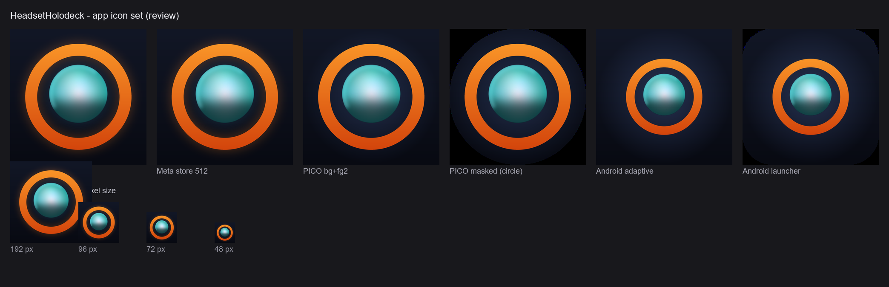

# HeadsetHolodeck app icons

The app icon is one design serving both headset targets. Quest and PICO both read the Android
launcher slots from the APK, so the runtime icon set is shared; only the **store listing art** differs
per platform, and that lives beside the runtime set here.

The design is an LCARS amber ring — the holodeck doorway — around a glowing generated world on a deep
navy field. It uses the Ops panel palette (`Assets/App/UI/LCARS`, `m_Color` `1, 0.48, 0.04`) and
carries no lettering, which both stores require for the icon itself.



## Files

| Path | Size | Used for |
|---|---|---|
| `AppIcon/HolodeckAppIcon_master_1024.png` | 1024², opaque | Source master; desktop/splash and any new export |
| `AppIcon/Android/legacy_<px>.png` | 192/144/96/72/48² | Unity **Legacy** Android icon slots |
| `AppIcon/Android/round_<px>.png` | 192/144/96/72/48² | Unity **Round** Android icon slots |
| `AppIcon/Android/adaptive_foreground_432.png` | 432², RGBA | Adaptive layer 1 (foreground), art inside the 66 dp safe zone |
| `AppIcon/Android/adaptive_background_432.png` | 432², opaque | Adaptive layer 0 (background plate) |
| `AppIcon/Meta/Holodeck_Icon_512.png` | 512², 24-bit | Meta Horizon Store listing icon |
| `AppIcon/Pico/Holodeck_icon_bg_1024.png` | 1024², opaque | PICO layered icon, background layer |
| `AppIcon/Pico/Holodeck_icon_fg2_1024.png` | 1024², RGBA | PICO layered icon, `icon_fg2` layer |
| `AppIcon/Pico/Holodeck_Icon_512.png` | 512², opaque | PICO single-file store icon |

Store art is deliberately **not** flattened into the Unity slots: Meta wants squared corners and no
alpha, PICO wants a circular-safe foreground layer, and Android masks the adaptive pair itself.

## Applying, and regenerating

Apply or re-apply the art to Player Settings from the editor:

```
Headset Holodeck > App Icons > Apply to Both Targets (global + Pico profile)
Headset Holodeck > App Icons > Apply to Current Configuration Only
Headset Holodeck > App Icons > Report Assigned Icons
```

**Use "Apply to Both Targets".** Unity 6 Build Profiles capture Player Settings as profile overrides,
so the two builds read different stores of the same setting:

| Build | Reads |
|---|---|
| Pico (`Headset Holodeck > Build > Build Pico APK`) | `Assets/App/Platforms/Pico/Settings/Pico.asset` |
| Meta (`Headset Holodeck > Build > Build Meta APK`) | global `ProjectSettings/ProjectSettings.asset` (that menu deactivates the Pico profile first) |

Applying in only one configuration leaves the other build icon-less, and nothing warns you: both
paths look correct from the Player Settings inspector because it shows whichever is active.

Unattended equivalent:

```bash
Unity -batchmode -quit -projectPath <repo> \
  -executeMethod Holodeck.Editor.AppIconSetup.ApplyFromCommandLine \
  -logFile Logs/appicon-setup.log
```

`ApplyFromCommandLine` writes only the configuration that is active in that editor session, so for a
full pass run it twice, once per configuration, or use the dual-target menu item.

`File/Save Project` and `AssetDatabase.SaveAssets()` do not flush Player Settings. The applier saves
the settings asset explicitly; if you edit icons by hand, change one and let the profile save, then
verify by grepping the two files for `fileID: 2800000`.

The PNGs are generated, not hand-painted. To change the art, edit
`docs/branding/app-icon/build_app_icons.py` (geometry and palette at the top of the file), run it,
then apply. Concept explorations and the platform requirement notes are in
[`docs/branding/app-icon/README.md`](../../../../docs/branding/app-icon/README.md).
