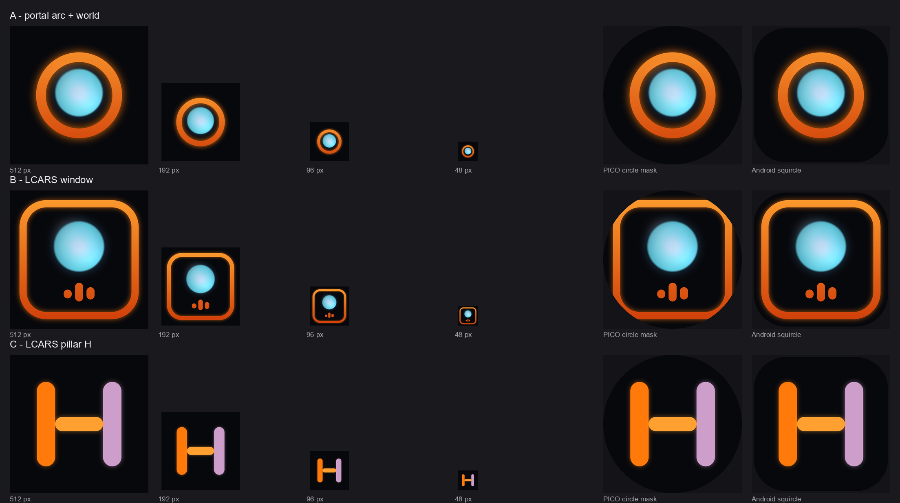

# App icon: design, platform requirements, regeneration

One design serves both headsets, because Quest and PICO both read the Android launcher icon slots
from the APK. What differs per platform is the **store listing art**, which this folder produces for
each store.



Chosen concept: **A, the portal ring** — an LCARS amber ring around a glowing generated world on a
deep navy field. It reads at 48 px, survives both launcher masks, carries no lettering (the stores
forbid title text on the icon), and borrows the Ops panel's exact amber
(`#FF7A0A`, `m_Color: 1, 0.48, 0.04` in `Assets/App/UI/LCARS/Prefabs`).

The ring is the holodeck doorway; the sphere is the world the app generates from a sentence. Concept
B (LCARS window) was kept in `concepts/` because it is the better choice if the brand ever pivots to
"the panel is the product".

## Files

| File | Purpose |
|---|---|
| `build_app_icons.py` | Builds the shippable set into `Assets/App/UI/Branding/AppIcon` |
| `generate_icons.py` | Renders the three concept candidates + contact sheet (exploration only) |
| `make_review.py` | Renders `review/icon-set-review.png` — the verification sheet |
| `concepts/` | Concept art (A/B/C) and the contact sheet |
| `review/` | Review sheet for the shipped set |

## What each platform actually requires

| Requirement | Value | Source |
|---|---|---|
| Meta listing icon | 512×512, 24-bit PNG, square corners, solid fill, no alpha, must depict the experience rather than the company, no title text | [Meta asset guidelines](https://developers.meta.com/horizon/resources/asset-guidelines/) |
| Meta spatialized layers (optional) | background + foreground-with-alpha, 180×180, foreground inside an 18 dp safe area | same |
| PICO store icon | 1:1, at least 380 px wide, one file | [PICO app information review](https://developer-cn.picoxr.com/document/distribute/en_app-information-review/) |
| PICO layered icon (required to publish) | `icon_bg` + `icon_fg2` (+ optional `icon_fg3`), PNG 1024×1024, ≤4 MB per layer, sRGB/P3, art inside the inscribed circle, opaque background inside the circle, no baked shadows, avoid pure black | [PICO app icon and layered design](https://developer.picoxr.com/document/spatial-design/app-icon/) |
| Android adaptive icon | 108 dp layers, 18 dp margin on all sides reserved for masking/parallax, core art within the 66 dp safe area; logo between 48 dp and 66 dp | [Android adaptive icons](https://developer.android.com/develop/ui/views/layout/icon-design/adaptive) |
| Android legacy densities | 48 / 72 / 96 / 144 / 192 px mipmaps | [Android screen densities](https://developer.android.com/training/multiscreen/screendensities) |
| Unity slots | Player Settings ▸ Icon exposes Legacy, Round and Adaptive sets per build target | [Unity Android Player settings](https://docs.unity3d.com/6000.2/Documentation/Manual/class-PlayerSettingsAndroid.html) |

Design consequences baked into `build_app_icons.py`:

- The field is deep navy `#121726` → `#0A0C12`, not pure black, and the art spans 78% of the canvas so
  it stays inside a circular PICO mask without touching the edge.
- The adaptive foreground is scaled to 56/108 so the ring sits inside the 66 dp safe area, and the
  adaptive background is a plain field: Android parallaxes the two layers, so a ring-shaped glow
  baked into the background would drift out of alignment.
- Dark-on-dark glow is kept subtle for the same reason — a soft bloom baked into a layer reads as
  misregistration when that layer moves.

### Unverified / worth knowing

- PICO publishes the inscribed-circle rule but no numeric padding percentage; 78% is our choice.
- Meta documents the store listing icon and the 180×180 spatialized layers as the library tile
  source. Whether the headset library also falls back to the APK launcher icon is not documented, so
  both the store art and the APK slots are shipped.
- Neither store publishes a contrast requirement beyond "legible when scaled down"; the white-ish
  sphere on navy is roughly 12:1.
- LCARS is Star Trek IP. Meta states it does not review assets for IP infringement, so the styling
  choice is a product decision rather than a compliance one; if that changes, recolouring the ring is
  a two-line edit in `build_app_icons.py` (the geometry is independent of the palette).

## Regenerate

```bash
python docs/branding/app-icon/build_app_icons.py     # writes Assets/App/UI/Branding/AppIcon
python docs/branding/app-icon/make_review.py         # writes review/icon-set-review.png
```

Then apply the runtime slots in Unity: **Headset Holodeck ▸ App Icons ▸ Apply to Android Player
Settings** (or `Holodeck.Editor.AppIconSetup.ApplyFromCommandLine` in batchmode). See
[`Assets/App/UI/Branding/README.md`](../../../Assets/App/UI/Branding/README.md).

To restyle, edit the constants at the top of `build_app_icons.py`:

| Constant | Effect |
|---|---|
| `RING_R`, `RING_W` | ring outer radius and band width |
| `ORB_R`, `ORB_DY` | world radius and vertical lift |
| `AMBER_HI`, `AMBER_LO` | ring gradient |
| `FIELD_TOP`, `FIELD_BOTTOM` | background field |

`ART_SPAN` follows `RING_R`; the per-platform scale factors in `main()` are expressed against it, so
enlarging the ring keeps every export inside its safe area.

## Applying the runtime slots

`Headset Holodeck > App Icons > Apply to Both Targets (global + Pico profile)` — or
`Holodeck.Editor.AppIconSetup.ApplyToBothTargets()`.

"Both" is the important word. Unity 6 Build Profiles capture Player Settings as profile overrides, so
this project stores two independent copies of the same Android icon slots:

| Build | Store |
|---|---|
| Pico | `Assets/App/Platforms/Pico/Settings/Pico.asset` |
| Meta | global `ProjectSettings/ProjectSettings.asset` |

Applying in only one configuration leaves the other build icon-less, and the Player Settings
inspector will not tell you which one you just edited. Verification that actually settles it: grep
both files for `fileID: 2800000` — a complete pass is 24 texture references in each (5 legacy +
5 round with the 36 px slot reusing 48, plus 6 adaptive slots × 2 layers). `AppIconSetup.Describe()`
returns the same information from the live editor.

`File/Save Project` and `AssetDatabase.SaveAssets()` do not flush Player Settings; the applier saves
the settings asset explicitly, and the profile asset is written when the profile is saved.

## Evidence

Applied 2026-10-31: both stores carried the 24 references above, all GUIDs resolving to
`Assets/App/UI/Branding/AppIcon/**`, with the adaptive pair ordered background then foreground.
Not yet verified: the `res/mipmap-*` contents of a built APK, or how the icon looks on Quest or
PICO hardware.
